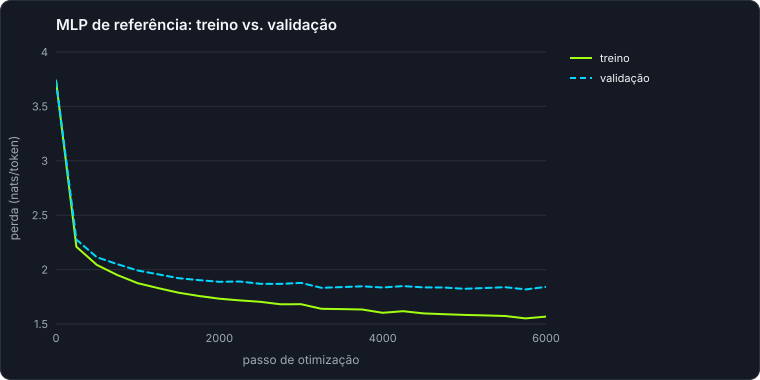
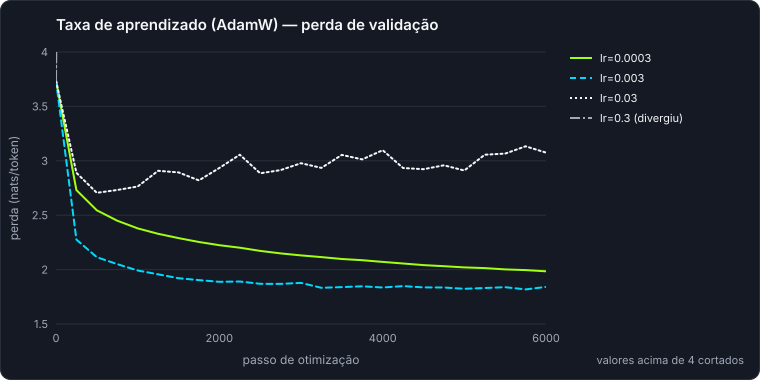
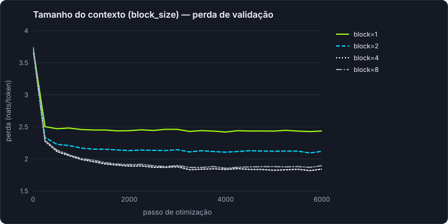
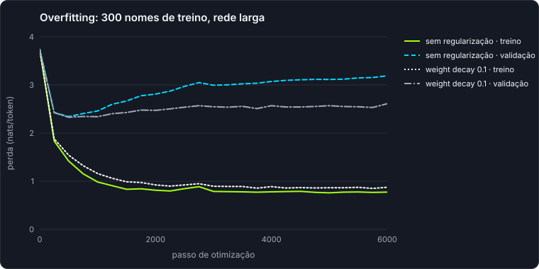
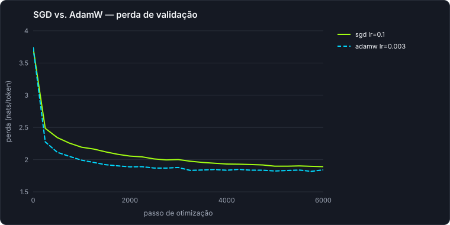

# Resultados dos experimentos

> Arquivo gerado por `python -m llmzero experiments`. Não edite à mão.

Ambiente: Python 3.14.3, NumPy 2.5.4, Windows-11-10.0.26200-SP0.

## Referências

- Vocabulário: 42 tokens (caracteres + fronteira)
- Sequências: 4240 treino / 529 validação / 529 teste (semente 1234)
- Perda de um modelo uniforme, ln(V): **3.7377**
- Perda de validação do bigrama por contagem (alpha=1): **2.3851**

## baseline

| execução | parâmetros | nomes de treino | treino final | validação final | melhor validação (passo) | inéditos | copiados do treino | tempo (s) |
|---|---:|---:|---:|---:|---:|---:|---:|---:|
| mlp | 18746 | 4240 | 1.5680 | 1.8414 | 1.8178 (5750) | 97% | 3% | 15.58 |

Perda no conjunto de **teste** (`mlp`, avaliada uma única vez): **1.8190**

Amostras (temperatura 1.0, semente 7):

- `mlp`: morico, romeleirauneé, cocalista, campinas, cristó, merdo, graçes, miranga

## learning_rate

| execução | parâmetros | nomes de treino | treino final | validação final | melhor validação (passo) | inéditos | copiados do treino | tempo (s) |
|---|---:|---:|---:|---:|---:|---:|---:|---:|
| lr=0.0003 | 18746 | 4240 | 1.8931 | 1.9841 | 1.9841 (6000) | 100% | 0% | 11.45 |
| lr=0.003 | 18746 | 4240 | 1.5680 | 1.8414 | 1.8178 (5750) | 97% | 3% | 11.3 |
| lr=0.03 | 18746 | 4240 | 2.8076 | 3.0758 | 2.7056 (500) | 98% | 1% | 11.46 |
| lr=0.3 ⚠ divergiu | 18746 | 4240 | — | — | 3.7368 (0) | — | — | 2.66 |

Amostras (temperatura 1.0, semente 7):

- `lr=0.0003`: ovilan, são gnaquís velm copárenda, par, santanho, marbe, inatayposo, ilhaz dentantão, curatminda
- `lr=0.003`: morico, romeleirauneé, cocalista, campinas, cristó, merdo, graçes, miranga
- `lr=0.03`: porantana, itama, vará, campos n'de, erenço dorek, araçu do cugá pomanchas, para, serna

## context

| execução | parâmetros | nomes de treino | treino final | validação final | melhor validação (passo) | inéditos | copiados do treino | tempo (s) |
|---|---:|---:|---:|---:|---:|---:|---:|---:|
| block=1 | 11546 | 4240 | 2.4025 | 2.4356 | 2.4187 (4000) | 100% | 0% | 10.02 |
| block=2 | 13946 | 4240 | 2.0283 | 2.1190 | 2.0926 (5750) | 100% | 0% | 10.48 |
| block=4 | 18746 | 4240 | 1.5680 | 1.8414 | 1.8178 (5750) | 97% | 3% | 11.14 |
| block=8 | 28346 | 4240 | 1.4596 | 1.8944 | 1.8536 (4000) | 96% | 4% | 13.78 |

Amostras (temperatura 1.0, semente 7):

- `block=1`: nto do, stiigoamiúnhão m, amesinha, co d'á, cuisiranho m diardáponialaiaz ngundosápe, cuibunhaja, sangu, ga
- `block=2`: mora sante, diaanópoxbel alisconcalmei, santerro, mirana, ferixerre mel verespastria, seirangi, aramena, alândio minhos
- `block=4`: morico, romeleirauneé, cocalista, campinas, cristó, merdo, graçes, miranga
- `block=8`: moradu, romeiras, álhão, machatinho, coli novo, são miguel dos vies bomicão, estintôna, timpoi mamos

## overfitting

| execução | parâmetros | nomes de treino | treino final | validação final | melhor validação (passo) | inéditos | copiados do treino | tempo (s) |
|---|---:|---:|---:|---:|---:|---:|---:|---:|
| sem regularização | 36946 | 300 | 0.7735 | 3.1913 | 2.3425 (500) | 76% | 24% | 9.96 |
| weight decay 0.1 | 36946 | 300 | 0.8748 | 2.6105 | 2.3273 (500) | 90% | 10% | 10.16 |

Amostras (temperatura 1.0, semente 7):

- `sem regularização`: são do rio do oeste, carambeí, pederneia, chapadão do piauí, pérola d'oeste, sengés, caseiro, pederneira
- `weight decay 0.1`: presidenteira douraç, chapadão do guar jborás, santo, passabéz do guaratingueiras, caspeurina, araperes, cupira, pimentenaporã

## optimizer

| execução | parâmetros | nomes de treino | treino final | validação final | melhor validação (passo) | inéditos | copiados do treino | tempo (s) |
|---|---:|---:|---:|---:|---:|---:|---:|---:|
| sgd lr=0.1 | 18746 | 4240 | 1.7162 | 1.8910 | 1.8910 (6000) | 98% | 2% | 10.17 |
| adamw lr=0.003 | 18746 | 4240 | 1.5680 | 1.8414 | 1.8178 (5750) | 97% | 3% | 10.91 |

Amostras (temperatura 1.0, semente 7):

- `sgd lr=0.1`: moricu, rlogeiro âniô, apahu, serra, bois, reguiupianiram de noásinha de verdirapár, mamte, serra
- `adamw lr=0.003`: morico, romeleirauneé, cocalista, campinas, cristó, merdo, graçes, miranga
